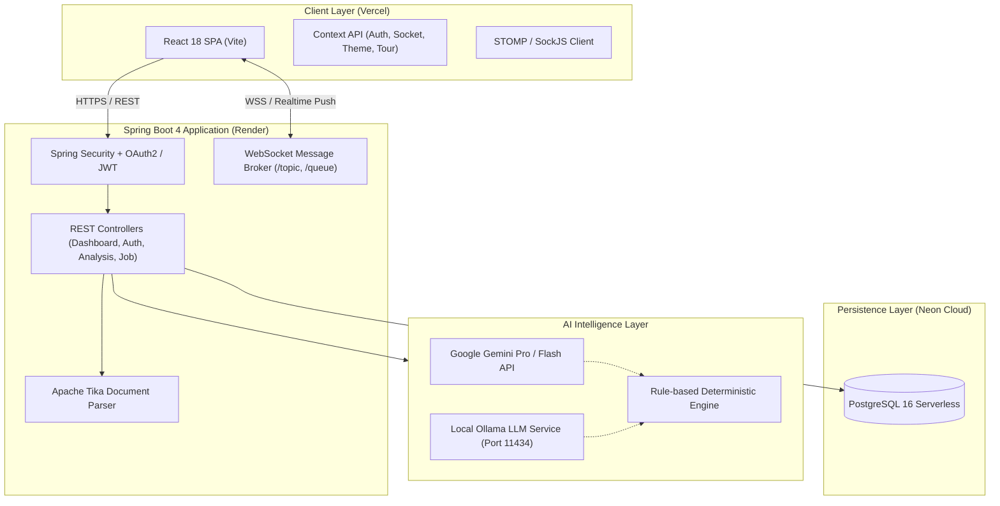

# 🚀 SmartHire — Next-Gen AI Resume Analyzer & Recruitment Platform

[](https://spring.io/projects/spring-boot)
[](https://www.oracle.com/java/)
[](https://react.dev/)
[](https://vitejs.dev/)
[](https://neon.tech/)
[](https://ai.google.dev/)
[](https://resume-analyzer-sigma-nine.vercel.app)

> **SmartHire** is an enterprise-grade, full-stack recruitment intelligence platform designed to bridge the gap between job seekers and recruiters. Powered by hybrid AI engines (Google Gemini API, Local Ollama LLM, and rule-based heuristics), SmartHire delivers deep ATS compatibility scanning, automated candidate pipelines, real-time WebSocket notifications, and multi-round interview management.

---

## 🌐 Live Production Links

- **🚀 Live Application (Frontend)**: [https://resume-analyzer-sigma-nine.vercel.app](https://resume-analyzer-sigma-nine.vercel.app)
- **⚡ Backend API Service**: [https://samarthire-api.onrender.com](https://samarthire-api.onrender.com)
- **🗄️ Database**: [Neon Serverless Cloud PostgreSQL](https://neon.tech)

---

## ✨ Key Platform Features

### 1. 🤖 Multi-Provider AI Resume & ATS Intelligence Engine
- **Hybrid AI Fallback Architecture**: Seamless automatic failover between **Google Gemini 1.5 Flash/Pro**, **Local Ollama LLM (`codellama`, `llama3`)**, and an offline **Deterministic Heuristics Engine**.
- **Deep ATS Scoring (0–100%)**: Evaluates keyword frequency, section integrity, formatting cleanliness, role requisitions, and skills relevance.
- **Skills Matrix & Gap Analysis**: Automatically extracts technical competencies, soft skills, certifications, and highlights missing benchmark skills for target job titles.
- **Document Ingestion**: High-throughput parsing of `.pdf`, `.docx`, and `.txt` files using **Apache Tika** with layout preservation.
- **Print & PDF Export**: Generates clean, printer-friendly reports with zero page-overflow issues.

### 2. 👥 Dual-Portal Role-Based Access Control (RBAC)
- **Job Seeker Portal**:
  - Instant resume uploads and ATS compatibility reports.
  - Tailored interview preparation and interactive improvement plans.
  - Live status tracking of job applications.
  - Self-service **Account Role Switcher** with single-tenant isolation.
- **HR & Recruiter Portal**:
  - Full candidate lifecycle pipeline: `Under Review` ➔ `Shortlisted` ➔ `Interviewing` ➔ `Offered` ➔ `Hired` / `Rejected`.
  - 1-click shortlist toggling with instantaneous candidate alerts.
  - Multi-round technical interview scheduling with auto-generated Google Meet room links.
  - Confidential interviewer scorecard with multi-criteria ratings (Technical, Communication, Architecture) and structured recommendations (`Next Round`, `Strong Hire`, `Hold`, `Reject`).
  - Batch / bulk resume screening for high-volume recruitment drives.

### 3. 🔔 Real-Time Notification & Activity Center
- **WebSocket (STOMP / SockJS)** live streaming directly to the client with graceful HTTP REST polling fallback.
- **Dynamic & Humanized Event Notifications**:
  - ⭐ **Shortlisted**: Personalized congratulations note with hiring manager and company details.
  - ⚠️ **Removed from Shortlist**: Transparent status update informing the candidate their profile returned to active review.
  - 📅 **Interview Scheduled & Rescheduled**: Complete schedule breakdown with date, time, interviewer, platform, meeting link, and HR guidelines.
  - ❌ **Interview Cancelled**: Cancellation reason and reassurance of ongoing profile review.
  - 📋 **Interview Feedback**: Immediate outcome notification (`Next Round`, `Hire`, `Score %`).
  - ⏳ **Under Review & Progression**: Active pipeline movement alerts.
- **Universal UTC Synchronization**: Eliminates timezone skew across servers and clients; displays both relative time (*"Just now"*, *"2 mins ago"*) and exact local wall-clock timestamps (*"13 Nov 2026, 10:51 AM"*).

### 4. 🔒 Enterprise Security & Single Sign-On (SSO)
- **Google OAuth2 SSO**: Direct one-click login for both candidates and recruiters with intelligent mismatch handling (auto-redirecting to correct portal tab).
- **Stateless JWT + Spring Security**: Dual-tier security supporting JWT authorization tokens with HTTP-only session resilience.
- **Session Isolation**: Separate storage keys avoiding multi-account crossover between candidate and recruiter browser windows.

---

## 🏗️ Architecture Overview



---

## 💻 Tech Stack

| Domain | Technologies Used |
|---|---|
| **Backend Framework** | Spring Boot 4.1.2, Spring MVC, Spring Data JPA, Spring Security 6 |
| **Language & Runtime** | Java 25 (OpenJDK), Maven Wrapper (`mvnw`) |
| **Frontend Framework** | React 18, Vite 8, React Router v6, Axios |
| **Styling & UI** | Pure Modern CSS, Custom Dark/Light Themes, Bootstrap Icons |
| **Real-time Messaging** | Spring WebSocket, STOMP protocol, SockJS |
| **Database** | PostgreSQL on Neon (Serverless AWS) |
| **Document Processing**| Apache Tika Core 3.2.3, Commons IO |
| **AI Providers** | Google Gemini API, Ollama (CodeLlama / Llama 3) |
| **Authentication** | Google OAuth2 Client, JJWT (io.jsonwebtoken 0.12.6) |
| **Hosting & CI/CD** | Render (Web Service), Vercel (Frontend), GitHub Actions |

---

## 📂 Project Structure

```text
Smart-Hire/
├── .github/                     # GitHub workflows and CI configurations
├── frontend/                    # Modern React + Vite Single Page Application
│   ├── src/
│   │   ├── api/                 # Axios HTTP client configuration & interceptors
│   │   ├── components/          # Reusable UI widgets, Modals, Topbar, Sidebar
│   │   ├── context/             # Global Contexts: Auth, Theme, Notifications, Onboarding
│   │   ├── pages/               # Views: Dashboard, Login, Register, Analysis, Notifications
│   │   └── utils/               # DateTime formatters, token decoders, WebSocket handler
│   ├── vite.config.js           # Vite build and proxy settings
│   └── package.json             # Frontend dependencies & scripts
├── src/main/java/com/smarthire/ # Spring Boot 4 Enterprise Backend
│   ├── ai/                      # AI provider implementations (Gemini, Ollama, Heuristic)
│   ├── config/                  # Security, WebSocket, Jackson, MVC configs
│   ├── controller/              # REST API controllers & Web endpoints
│   ├── entity/                  # JPA Entities: User, ResumeAnalysis, Notification, Job
│   ├── repository/              # Spring Data JPA database repositories
│   ├── security/                # JWT filters, OAuth2 handlers, UserDetailsService
│   └── service/                 # Business logic, Tika parsing, Realtime notification service
├── src/main/resources/          # Application configuration, templates, and static assets
├── pom.xml                      # Maven project dependencies & plugins
├── Dockerfile                   # Production container definition for Render
└── README.md                    # Project documentation
```

---

## 🛠️ Local Development & Setup

### Prerequisites
- **Java JDK 21 or 25** installed (`java -version`)
- **Node.js 18+** & **npm** installed (`node -v`, `npm -v`)
- **PostgreSQL** instance running (or use Neon Cloud URL)
- *(Optional)* **Ollama** running locally on port `11434` for offline AI inference

---

### Step 1: Clone the Repository
```bash
git clone https://github.com/rakeshrathore8658-stack/Smart-Hire.git
cd Smart-Hire
```

---

### Step 2: Configure Environment Variables
Create an `application-local.properties` or set environment variables in your terminal:

```properties
# Database Configuration
SPRING_DATASOURCE_URL=jdbc:postgresql://localhost:5432/smarthire
SPRING_DATASOURCE_USERNAME=postgres
SPRING_DATASOURCE_PASSWORD=yourpassword

# Google OAuth2 Credentials
SPRING_SECURITY_OAUTH2_CLIENT_REGISTRATION_GOOGLE_CLIENT_ID=your-google-client-id
SPRING_SECURITY_OAUTH2_CLIENT_REGISTRATION_GOOGLE_CLIENT_SECRET=your-google-client-secret

# Google Gemini API
GEMINI_API_KEY=your-gemini-api-key

# JWT Secret
JWT_SECRET=YourSuperSecretKeyWithMinimum256BitsLengthForSecurity123456
```

---

### Step 3: Run the Backend Service
```bash
# Using Maven Wrapper (Windows)
.\mvnw.cmd spring-boot:run

# Using Maven Wrapper (Linux / macOS)
./mvnw spring-boot:run
```
*Backend will start on `http://localhost:8080`.*

---

### Step 4: Run the Frontend (Vite)
Open a new terminal window:
```bash
cd frontend
npm install
npm run dev
```
*Frontend will launch at `http://localhost:5173`.*

---

## 🧪 Testing & Verification

Run the full automated test suite (Unit, Integration, Security, and REST APIs):
```bash
# Run Maven Tests
.\mvnw.cmd test

# Build Frontend Production Assets
cd frontend && npm run build
```

---

## 🤝 Contributing

Contributions, issues, and feature requests are welcome!
1. Fork the Project.
2. Create your Feature Branch (`git checkout -b feature/AmazingFeature`).
3. Commit your Changes (`git commit -m 'feat: Add some AmazingFeature'`).
4. Push to the Branch (`git push origin feature/AmazingFeature`).
5. Open a Pull Request.

---

## 📄 License

Distributed under the **MIT License**. See `LICENSE` for more information.

---

<p align="center">
  Crafted with ❤️ by <a href="https://github.com/rakeshrathore8658-stack"><strong>Rakesh Rathore</strong></a>
</p>
