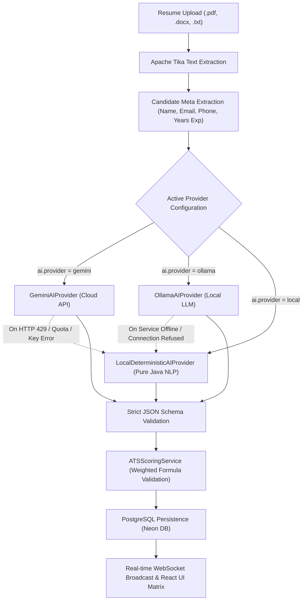
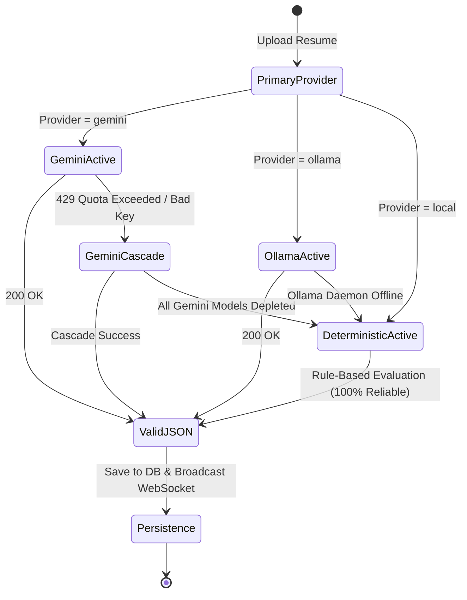

# 📄 SmartHire AI Resume Analysis Engine: Deep-Dive Architecture & Formula Specification

> **Technical Architecture Specification & Mathematical Formulation Document**  
> *Project:* SmartHire (AI-Powered Resume ATS Analyzer & Recruiter Platform)  
> *Author:* SmartHire Core Engineering Team  
> *Version:* 2.0.0 (Production Architecture)

---

## 📑 Table of Contents
1. [Executive Overview & Architecture Diagram](#1-executive-overview--architecture-diagram)
2. [ATS Overall Score: Exact Mathematical Formula](#2-ats-overall-score-exact-mathematical-formula)
   - [7 Evaluation Dimensions & Weights Table](#7-evaluation-dimensions--weights-table)
   - [Match Level Thresholds](#match-level-thresholds)
3. [Provider Mode 1: Google Gemini API (Cloud LLM)](#3-provider-mode-1-google-gemini-api-cloud-llm)
   - [Dynamic System Prompting](#dynamic-system-prompting)
   - [Multi-Model Dynamic Cascade Fallback](#multi-model-dynamic-cascade-fallback)
   - [Inference & Deterministic Hyperparameters](#inference--deterministic-hyperparameters)
4. [Provider Mode 2: Local Ollama LLM (Air-Gapped & Private)](#4-provider-mode-2-local-ollama-llm-air-gapped--private)
   - [Local Inference Execution Flow](#local-inference-execution-flow)
   - [Context Window & Chain-of-Thought Parsing](#context-window--chain-of-thought-parsing)
5. [Provider Mode 3: Local Deterministic / Rule-Based NLP Engine](#5-provider-mode-3-local-deterministic--rule-based-nlp-engine)
   - [Technical Skill Dictionary & Taxonomy Bank](#1-technical-skill-dictionary--taxonomy-bank)
   - [Role Taxonomy Matching Algorithm](#2-role-taxonomy-matching-algorithm)
   - [Experience & Seniority Regex Parsing](#3-experience--seniority-regex-parsing)
   - [Projects Depth & Verification Scoring](#4-projects-depth--verification-scoring)
   - [Quantifiable Impact & Action Verb Multipliers](#5-quantifiable-impact--action-verb-multipliers)
6. [Self-Healing Failover Matrix](#6-self-healing-failover-matrix)
7. [Unified JSON Output Schema & Database Persistence](#7-unified-json-output-schema--database-persistence)

---

## 1. Executive Overview & Architecture Diagram

SmartHire implements a resilient, multi-tiered resume analysis pipeline capable of operating under three distinct execution paradigms:
1. **Cloud LLM (Google Gemini API):** State-of-the-art semantic reasoning with automatic multi-model failover.
2. **Local LLM (Ollama):** Fully private, on-premise inference with zero external network dependencies.
3. **Pure Java Deterministic Heuristic Engine:** Fast, standalone, rule-based Natural Language Processing (NLP) with zero AI or internet requirements.



---

## 2. ATS Overall Score: Exact Mathematical Formula

The ATS Overall Score represents a composite index between **0 and 100**, calculated by computing the weighted linear combination of **7 distinct evaluation vectors**:

$$\text{Overall ATS Score} = \sum_{i=1}^{7} (W_i \times S_i)$$

$$\text{Overall ATS Score} = (S \times 0.30) + (E \times 0.20) + (P \times 0.15) + (Ed \times 0.10) + (K \times 0.10) + (F \times 0.10) + (Q \times 0.05)$$

### 7 Evaluation Dimensions & Weights Table

| Dimension | Symbol | Weight ($W_i$) | Algorithmic Evaluation Logic | Source File Reference |
|---|:---:|:---:|---|---|
| **Skills Match** | $S$ | **30% (0.30)** | Semantic intersection ratio between candidate's extracted technical competencies and the target job role's required skill taxonomy. | `ATSScoringService.java:L45` |
| **Experience & Tenure** | $E$ | **20% (0.20)** | Total professional tenure, relevance of job titles, progression velocity, and seniority level indicators. | `ATSScoringService.java:L46` |
| **Projects & Practical Work** | $P$ | **15% (0.15)** | Depth and volume of real-world projects, presence of active GitHub URLs, live deployments, and architectural scope. | `ATSScoringService.java:L47` |
| **Education & Certifications** | $Ed$ | **10% (0.10)** | Academic qualification relevance (B.Tech, MCA, M.Tech, BS/MS) plus industry credentials (AWS, GCP, CKA, Oracle). | `ATSScoringService.java:L48` |
| **Job Description Keywords** | $K$ | **10% (0.10)** | Exact and fuzzy keyword overlap against recruiter job descriptions, tools, and libraries. | `ATSScoringService.java:L49` |
| **Formatting & Readability** | $F$ | **10% (0.10)** | Structural parsing viability: presence of clear headings, contact details, dates, standard bullet points, and absence of parsing anomalies. | `ATSScoringService.java:L50` |
| **Content Quality & Metrics** | $Q$ | **5% (0.05)** | Density of strong action verbs (*"architected"*, *"spearheaded"*, *"engineered"*) and quantifiable business outcomes (*"reduced latency by 45%"*). | `ATSScoringService.java:L51` |

### Match Level Thresholds

The resulting composite score maps directly into categorized recruitment pipelines:

```
┌───────────────────────────────┬───────────────────────────────┬──────────────────────────────────────────┐
│ Score Range                   │ Classification                │ Operational Pipeline Action              │
├───────────────────────────────┼───────────────────────────────┼──────────────────────────────────────────┤
│ 75.00% – 100.00%              │ ⭐ Strong Match               │ Automatically queued for HR Interview    │
│ 50.00% – 74.99%               │ ⚖️ Moderate Match             │ Flagged for Skill Gap Upskilling Review  │
│ 0.00% – 49.99%                │ ⚠️ Needs Optimization         │ Highlight Critical Missing Prerequisites │
└───────────────────────────────┴───────────────────────────────┴──────────────────────────────────────────┘
```

---

## 3. Provider Mode 1: Google Gemini API (Cloud LLM)

### Dynamic System Prompting
Managed by `DynamicPromptBuilderService.java`. The prompt establishes a zero-shot, recruiter-grade persona demanding strict adherence to a machine-readable JSON schema:

```
You are an expert technical recruiter and Senior ATS Architect.
Analyze the provided candidate resume against the target role: "{targetRole}".
Evaluate across:
1. Required Core Skills (Categorize into matched, missing with severity HIGH/MEDIUM/LOW)
2. Years of relevant experience
3. Project credibility (GitHub, production deployments, system architecture)
4. Overall ATS Score (0-100) using strict mathematical weighting.

Return ONLY a valid JSON object matching the defined contract. No markdown decoration.
```

### Multi-Model Dynamic Cascade Fallback
To ensure continuous availability despite rate limits or regional quota exhausts, `GeminiAIProvider.java` implements a waterfall cascade:

```
[Target: gemini-2.5-flash] 
        │ (On HTTP 429 / 503 / 404)
        ▼
[Fallback 1: gemini-2.0-flash]
        │ (On HTTP 429 / 503 / 404)
        ▼
[Fallback 2: gemini-1.5-flash]
        │ (On HTTP 429 / 503 / 404)
        ▼
[Fallback 3: gemini-1.5-pro]
        │ (If all cloud keys/models fail)
        ▼
[Local Deterministic Heuristic Engine]
```

### Inference & Deterministic Hyperparameters
- **Endpoint:** `https://generativelanguage.googleapis.com/{version}/models/{model}:generateContent?key={API_KEY}`
- **Temperature:** `0.2` (Low randomness to preserve scoring consistency across repeated uploads)
- **Top-P:** `0.95`
- **Output Constraint:** `responseMimeType: "application/json"`
- **Timeout:** 45 seconds with connection abort guards.

---

## 4. Provider Mode 2: Local Ollama LLM (Air-Gapped & Private)

Designed for data-sensitive recruitment environments where candidate PII cannot leave private infrastructure.

### Local Inference Execution Flow
- **Service Endpoint:** `http://localhost:11434/api/generate` (Configurable via `ai.ollama.base-url`)
- **Default Model:** `codellama`, `llama3`, or `mistral`
- **HTTP Method:** `POST` with JSON payload:
  ```json
  {
    "model": "codellama",
    "prompt": "<Dynamic Prompt + Resume Text>",
    "stream": false,
    "format": "json",
    "options": {
      "temperature": 0.1,
      "top_p": 0.85,
      "num_ctx": 8192
    }
  }
  ```

### Context Window & Chain-of-Thought Parsing
1. **Extended Context (`num_ctx: 8192`):** Accommodates full multi-page resumes and extensive job descriptions without truncation.
2. **DeepSeek / Reasoner Guard:** If a reasoning model emits internal thoughts (`<think>...</think>`), the provider executes regular expression scrubbing before sending the content to Jackson JSON parser:
   ```java
   cleanedResponse = rawResponse.replaceAll("(?s)<think>.*?</think>", "").trim();
   ```

---

## 5. Provider Mode 3: Local Deterministic / Rule-Based NLP Engine

The cornerstone of SmartHire’s resilience is `LocalDeterministicAIProvider.java`. It executes **100% offline without any API keys, GPUs, or external libraries**, using deterministic linguistic heuristics and regex tokenization.

### 1. Technical Skill Dictionary & Taxonomy Bank
Contains an in-memory dictionary of over **60+ technical skill signatures** across 6 domains:
- **Languages:** Java, Python, JavaScript, TypeScript, C++, Go, Rust, Kotlin, SQL.
- **Frameworks:** Spring Boot, Hibernate, React, Angular, Vue, Next.js, Express, Django.
- **Cloud & DevOps:** AWS, Azure, GCP, Docker, Kubernetes, Terraform, CI/CD, Jenkins.
- **Databases:** PostgreSQL, MySQL, MongoDB, Redis, Cassandra, Oracle, Elasticsearch.
- **Architecture:** Microservices, REST APIs, GraphQL, Kafka, RabbitMQ, Event-Driven.

Word-boundary regex checking (`\b(?i)skill\b`) prevents false-positive substring matches (e.g., detecting "Go" inside "Google").

### 2. Role Taxonomy Matching Algorithm
For any target job role (e.g., *"Java Developer"*), the engine selects the corresponding required benchmark skills ($R$):
```java
// Example: Java Developer Core Skills Benchmark:
Set<String> required = ["Java", "Spring Boot", "Microservices", "REST APIs", "SQL", "Docker"];
```
1. Extracted candidate skills ($C$) are intersected with $R$:
   $$\text{Matched Skills} = C \cap R$$
   $$\text{Missing Skills} = R \setminus C$$
2. **Skill Score Calculation:**
   $$\text{Skills Score} = \left(\frac{|\text{Matched Skills}|}{|R|} \times 75\right) + \min(25, |C| \times 1.5)$$

### 3. Experience & Seniority Regex Parsing
The candidate text is analyzed for seniority indicators and temporal markers:
- **Executive / Architect Markers:** `Lead`, `Principal`, `Architect`, `Director` ➔ **Base 92**
- **Senior Tenure:** `5+ years`, `Senior Engineer`, `Senior Developer` ➔ **Base 88**
- **Mid-Level:** `3-4 years`, `Software Engineer` ➔ **Base 82**
- **Junior:** `1-2 years`, `Junior Developer`, `Associate` ➔ **Base 72**
- **Entry Level:** `Fresher`, `Graduate Trainee`, `Intern` ➔ **Base 58**

### 4. Projects Depth & Verification Scoring
1. Projects are identified by section header discovery (`Projects`, `Academic Projects`, `Key Work`).
2. **Project Count Points:**
   - 1 Project: 65
   - 2 Projects: 76
   - 3 Projects: 84
   - 4+ Projects: 92
3. **Verification Bonus:**
   - Presence of `github.com/` links: **+5 Points**
   - Presence of live URLs (`.vercel.app`, `.render.com`, `http://`, `https://`): **+3 Points**

### 5. Quantifiable Impact & Action Verb Multipliers
- **Action Verbs:** Scanned for high-impact verbs (*"architected"*, *"optimized"*, *"spearheaded"*, *"implemented"*, *"reduced"*). Each unique verb contributes +3 points up to a ceiling of 20.
- **Metrics Multiplier:** Text matching patterns like `\d+%\s*(increase|decrease|speedup|reduction)` or numeric benchmarks (`50k+ users`, `300ms`) award an immediate **+12 point bonus**.

---

## 6. Self-Healing Failover Matrix

SmartHire guarantees **zero-downtime resume parsing**. If any external service degrades, the platform executes graceful fallback without human intervention:



---

## 7. Unified JSON Output Schema & Database Persistence

Regardless of which underlying engine completes the analysis, the output is normalized into this strict JSON contract before persistence in the `resume_analyses` table:

```json
{
  "candidateName": "Rakesh Rathore",
  "candidateEmail": "rakesh@example.com",
  "candidatePhone": "+91 9876543210",
  "candidateExperience": "3.5 Years",
  "targetJobRole": "Java Developer",
  "overallScore": 84,
  "skillsScore": 88,
  "experienceScore": 82,
  "formattingScore": 90,
  "recommendation": "Strong candidate with comprehensive Spring Boot and REST API experience. Recommended for technical interview.",
  "matchedSkills": ["Java", "Spring Boot", "Hibernate", "PostgreSQL", "REST APIs", "Docker"],
  "missingSkills": [
    {
      "skill": "Kubernetes",
      "severity": "HIGH",
      "recommendation": "Complete fundamental container orchestration coursework."
    }
  ],
  "strengths": [
    "Production-grade microservices development experience",
    "Clean resume formatting compatible with modern ATS parsers",
    "Quantified performance improvements included in past projects"
  ],
  "improvements": [
    "Add cloud deployment details (AWS / Azure)",
    "Expand on unit testing frameworks (JUnit 5, Mockito)"
  ],
  "stage": "Shortlisted",
  "status": "ANALYZED",
  "createdAt": "2026-11-13T11:40:00Z"
}
```

---

## 📌 Summary of Core Advantages
1. **Uninterrupted Availability:** Never crashes when an AI API quota expires; automatically self-heals via the Local Rule-Based Engine.
2. **Transparent & Auditable:** Scoring is not a mysterious black box; every score is derived from the clear 7-weight linear formula.
3. **Data Privacy Compliant:** Easily toggle to Local Ollama or Deterministic modes for complete enterprise data isolation.
4. **Universal UTC Timestamps:** Accurate, timezone-synchronized records preserved across database and frontend layers.
